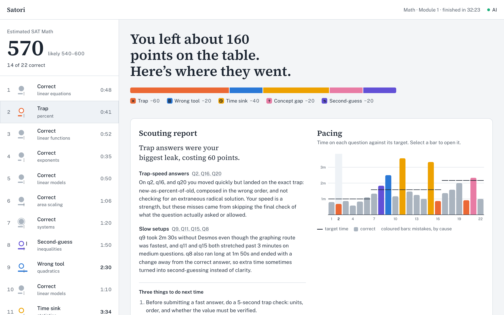
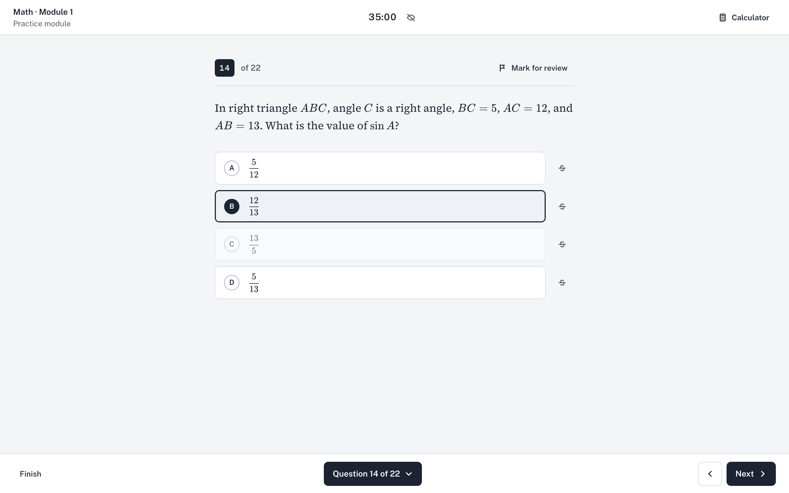
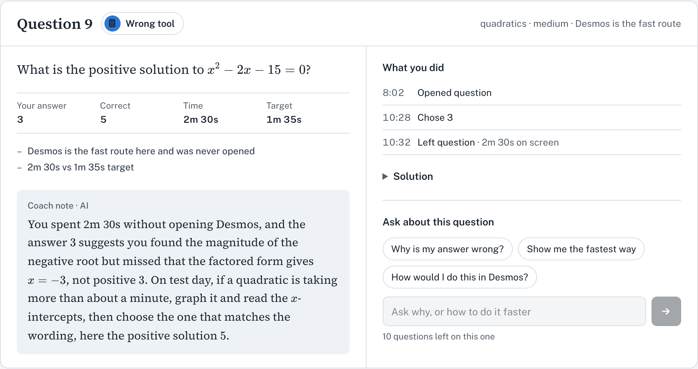
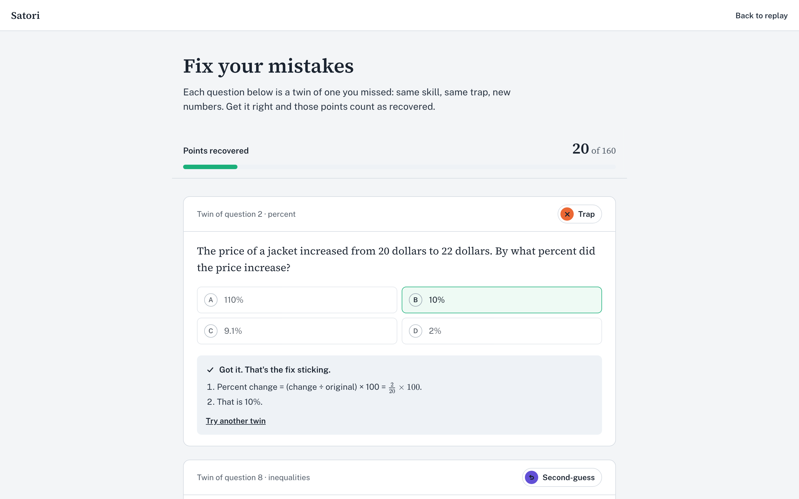
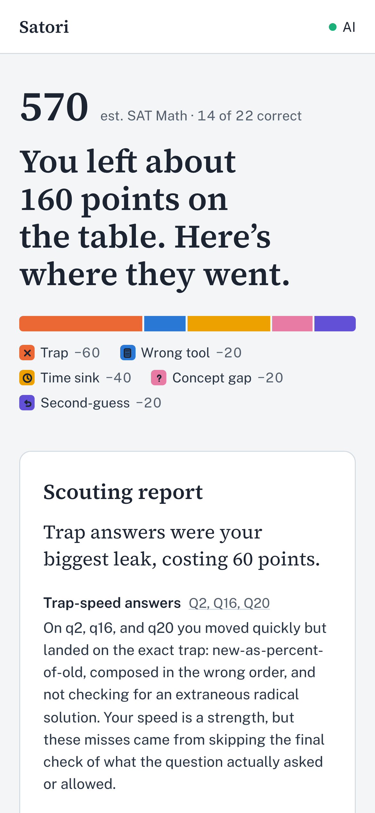
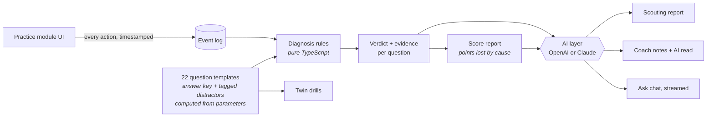

<div align="center">

# Satori

### SAT prep that shows you *why*.

Take a practice module. Satori watches **how** you work, then replays it like a chess engine reviewing your game:<br>
the trap you took, the minute you lost, the right answer you talked yourself out of, and what each one cost you in points.

<br>



</div>

---

## The problem

Every SAT prep app sells the same thing: a question bank, an AI chat, an adaptive plan and a score prediction. When you finish a practice test, they all tell you the same thing:

> **14 of 22 correct.** Review: quadratics, percentages, systems.

That's *what* you got wrong. It isn't *why*. And the why is usually not the topic:

- You knew the method but picked the answer **built to catch rushed readers**.
- You spent **three and a half minutes** on one question and still missed it.
- You had the right answer, **changed it**, and lost the point.
- You solved by hand what **Desmos would have shown in 20 seconds**.

Serious students track this by hand in spreadsheet "error logs". Satori does it for them, automatically, from the way they actually worked.

> *Satori* (悟り) is the Zen word for a moment of sudden understanding. It also has **SAT** in it.

---

## How it works for a student

### 1. Take a module, the way you would on test day

22 original SAT-style math questions, 35 minutes, a built-in Desmos graphing calculator, mark-for-review and answer cross-out. In the background, Satori records every action with a timestamp.



### 2. Watch the replay

Every question gets a **verdict with the evidence behind it**: the timeline of what you did, a coach note written by AI from that evidence, and a chat to ask about the question.



### 3. Fix the mistake, not just the question

Each miss becomes a **twin**: same skill, same trap, new numbers. Get it right and the points it cost you count as *recovered*.



<details>
<summary><b>And on a phone</b></summary>
<br>

</details>

---

## Ten verdicts, each with evidence

| Verdict | What happened | How Satori knows |
|---|---|---|
| **Trap** | You chose a wrong answer written to catch a known mistake | Every wrong choice is tagged with the misconception that produces it |
| **Time sink** | You spent over 2× the target time and still missed | Time on the question, summed across every visit |
| **Rushed** | Answered in about a third of the target time or less, and wrong | Same |
| **Second-guess** | You had the right answer, then changed it | Full answer history |
| **Wrong tool** | Desmos on a hand-solve question, or no Desmos where a graph is instant | Calculator open time overlapped with each visit |
| **Concept gap** | Nothing in your behaviour explains the miss | The fallback, with an *AI read* of the likely misconception |
| **Unanswered** | No answer, which is a guaranteed zero | |
| **Smart skip** | You left a hard question early and won later points with the time | Which later questions were still open when you left |
| **Brilliant** | A hard question, fast and right | |
| **Correct** | Right, in good time | |

Points lost are added up **by cause**, so the headline isn't "you got 8 wrong", it's *"traps cost you 60 points, two time sinks cost you 40"*.

---

## Under the hood



### Engineering choices worth a look

- **Correct by construction.** Questions are templates. The answer key *and every wrong choice* are computed from the parameters; the "sign error" distractor is literally the answer worked out with the sign flipped. Twins can't ship a wrong key. A test renders every template with 200 random parameter sets and checks it against an independently written solver.
- **The AI never grades.** Correctness, timing and verdicts come from deterministic code. The model gets the verified answer and solution as facts and is only asked to *explain*, through zod-validated structured output.
- **The server trusts nothing the client computes.** API routes receive only the raw event log, rebuild the verdicts themselves, and validate everything: event count, chat roles and turn limits, body size. Paid AI calls need a same-origin request, a signed session token, and pass shared (Redis) rate limits plus a daily spend cap.
- **Works offline.** With no API key, or if the model fails or times out, every AI surface falls back to pre-written coaching for that exact verdict and misconception. The demo never breaks.
- **Provider-agnostic.** One interface, two adapters: OpenAI (Responses API, `gpt-5.5`) and Anthropic (`claude-opus-5-5`, with prompt caching and refusal fallbacks). Set one key and it picks itself.
- **Hardened by real use.** A smoke test against the live model found TeX commands getting mangled inside JSON (`\frac` → form feed + `rac`). They're now repaired before rendering, with a regression test.
- **Accessible charts.** The verdict palette was checked with a colour-vision validator (it rejected the first palette). Verdicts are never colour-only, the question list is keyboard-navigable, and the timer announces 5:00 / 1:00 / 0:30 to screen readers instead of every second.

**Stack:** Next.js 16 · React 19 · TypeScript · Tailwind CSS 4 · Zustand · zod · KaTeX · Desmos API · Vitest · Playwright

---

## Run it locally

```bash
git clone https://github.com/mvmmarcus/satori.git && cd satori
npm install
cp .env.example .env.local   # optional: add OPENAI_API_KEY or ANTHROPIC_API_KEY for the AI coach
npm run dev                  # → http://localhost:3001
```

No key? Everything still works, and the coach runs on its pre-written notes.

| Variable | Purpose |
|---|---|
| `OPENAI_API_KEY` / `ANTHROPIC_API_KEY` | Enables the AI coach (either one) |
| `AI_PROVIDER` | Force `openai` or `anthropic` when both keys are set |
| `OPENAI_MODEL` / `ANTHROPIC_MODEL` | Override the default models |
| `SESSION_SECRET` | **Required in production.** Signs the session tokens the AI routes require (`openssl rand -hex 32`) |
| `UPSTASH_REDIS_REST_URL` / `_TOKEN` | Shared rate limiting across serverless instances (set automatically by Vercel's Upstash integration) |
| `AI_DAILY_LIMIT` | Hard cap on AI calls per day across all users (default 3000) |
| `ALLOWED_ORIGINS` | Extra origins allowed to call the API, comma-separated |
| `NEXT_PUBLIC_DESMOS_KEY` | Desmos API key. The bundled one is Desmos's public demo key; get a free production key before going live |

## Deploy to Vercel

1. Import the repo in Vercel.
2. Add **Upstash Redis** from the Vercel Marketplace (Storage tab) and connect it to the project.
3. Set `OPENAI_API_KEY` (or `ANTHROPIC_API_KEY`), `SESSION_SECRET` and `NEXT_PUBLIC_DESMOS_KEY`.
4. Set a monthly **spend limit** on your AI provider's dashboard.
5. Deploy. The build warns if `SESSION_SECRET` or the Desmos key is missing.

### Security model

- **AI routes are gated:** same-origin requests only, a signed 6-hour session token, and rate limits per IP (60 per 10 min), per session (40 per hour) and globally per day.
- **No answers mid-test:** the coach only responds to a finished module.
- **Server-side truth:** routes rebuild verdicts from the raw event log; nothing the client computes is trusted. Inputs are zod-validated and capped at 1 MB.
- **Headers:** a Content-Security-Policy (scripts limited to this site and Desmos), `frame-ancestors 'none'`, HSTS, `nosniff`, a strict referrer policy and a locked-down permissions policy.
- **Secrets** live only in server code; the Desmos key is the only public variable.

## Tests

```bash
npm test            # 153 unit tests: engine, templates × 200 random twins, recorder, diagnosis,
                    # scoring, persisted session, AI routes, fallbacks, rendering
npm run typecheck
npm run test:e2e    # browser flow, needs `npm run dev` running
npx tsx --env-file=.env.local scripts/ai-smoke.ts   # real model output on 3 sample sessions (uses API credits)
```

---

## Roadmap

- Reading & Writing section, and the two-module adaptive format of the real digital SAT
- Progress across modules: which habits are improving, which keep costing points
- ACT mode (the Enhanced ACT: shorter, Science optional)
- Teacher and tutor view: see a class's most expensive habits at a glance
- Accounts and sync across devices

## Limitations

- One 22-question Math module for now.
- The scaled score is a heuristic estimate, not an official conversion.

## Project layout

```
app/                 pages (/, /module, /replay, /drills) and API routes (coach, debrief, ask)
lib/content          question types, 22 templates, module order, fallback coaching copy
lib/engine           rendering, seeded RNG, answer checking
lib/recorder         event schema and per-question metrics
lib/diagnosis        verdict rules
lib/scoring          scaled estimate, points lost by cause
lib/ai               provider adapters, prompts, schemas, context builders, cache, rate limit, fallbacks
lib/store            persisted session
components/          UI
docs/                design spec, implementation plan, screenshots
```

<sub>Original practice questions written in SAT style. Not affiliated with or endorsed by College Board. SAT® is a trademark registered by College Board.</sub>
